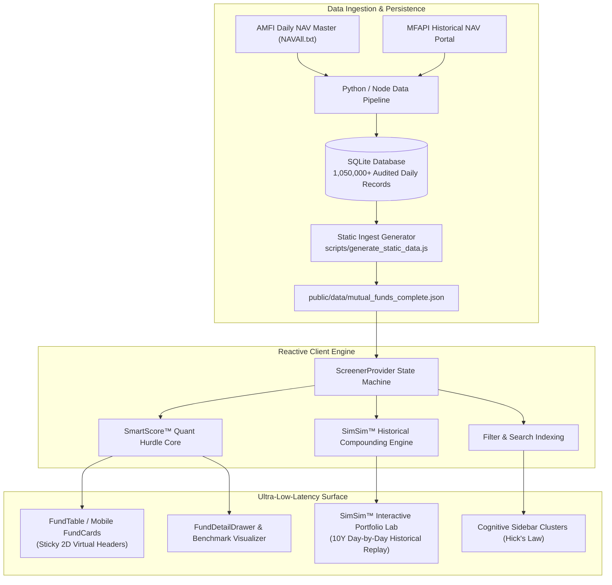

# BickerBape 📈

<p align="center">
  
</p>

<h3 align="center">Institutional Indian Equity Mutual Fund Screener & Compounding Engine</h3>

<p align="center">
  <strong>Absolute Financial Hurdle Scoring</strong> • <strong>Zero Estimations Policy</strong> • <strong>Fiduciary Seasoning Discipline</strong> • <strong>Audited AMFI & MFAPI Data</strong>
</p>

<p align="center">
  <a href="https://nextjs.org"></a>
  <a href="https://react.dev"></a>
  <a href="https://www.typescriptlang.org"></a>
  <a href="https://tailwindcss.com"></a>
  <a href="https://vitest.dev"></a>
  <a href="https://www.w3.org/WAI/standards-guidelines/wcag/"></a>
  <a href="#zero-estimations-policy"></a>
</p>

---

**BickerBape** is a high-performance, institutional-grade equity mutual fund intelligence platform engineered for the Indian investment landscape. Designed from first principles to eliminate retail marketing biases, BickerBape evaluates the universe of **active Direct-Growth equity mutual funds** using empirical quantitative hurdle models and a realistic historical simulation engine.

Built on **Next.js 16 (App Router client architecture)**, **React 19**, **Tailwind CSS 4**, and **Vitest**, BickerBape runs entirely as a blazingly fast, zero-server static deployment backed by official AMFI and MFAPI daily NAV audit streams.

---

## 🏛️ System Architecture



For complete architectural specifications, state machines, and render loops, see [docs/ARCHITECTURE.md](docs/ARCHITECTURE.md).

---

## 🔬 Core Innovations

### 1. SmartScore™ 4-Pillar Hurdle Model
Unlike conventional retail screeners that rank funds by arbitrary trailing returns, SmartScore™ measures true institutional alpha through four weighted pillars:

```
SmartScore™ = w_p · S_performance + w_t · S_track_record + w_r · S_risk + w_c · S_cost
```

* **Pillar 1: Category Return Ratios (Not Raw CAGR)**  
  Raw CAGR creates dangerous cyclical distortions (e.g. small-cap rallies outranking defensive large/flexi-cap all-weather compounders). We score return ratios directly against SEBI category averages:
  $$\text{Ratio}_{3Y} = \frac{\text{Fund 3Y CAGR}}{\text{Category Benchmark Average 3Y CAGR}}$$
  A ratio $\ge 1.35\times$ indicates top-decile alpha generation.

* **Pillar 2: Multi-Cycle Track Record & Fiduciary Seasoning**  
  Funds with $<3$ years of history have not survived a full bear-bull market cycle and are strictly barred from high scores:
  * **$<1$ Year (New Scheme)**: Track record score locked at $2.5/10$; overall score **capped at 5.8/10**.
  * **$1 - 3$ Years (Emerging)**: Track record score $4.5 - 5.5/10$; overall score **capped at 7.0/10**.
  * **$\ge 5$ Years**: Eligible for full institutional ratings ($\ge 8.0 - 9.5$).

* **Pillar 3: Downside Risk & Capital Preservation**  
  * **Annualized Daily Volatility ($\sigma$)**: Sample standard deviation scaled by $\sqrt{252}$.
  * **Sharpe Ratio**: Risk-adjusted excess return over RBI 10-Year Sovereign G-Sec Yield ($R_f = 6.80\%$).
  * **Sortino Ratio**: Downside semi-deviation penalizing only negative volatility below the Minimum Acceptable Return (MAR).
  * **Max Drawdown (MDD)**: Peak-to-trough historical loss across all recorded daily NAVs.
  * **Sector Concentration Penalty**: Thematic single-sector funds carry 100% idiosyncratic risk and receive an automatic $-1.5$ risk penalty with `⚠️ Sector Risk` tags.

* **Pillar 4: Direct Fee & TER Efficiency**  
  Rewards low Total Expense Ratios (TER 0.40–0.60%) in Direct-Growth plans, penalizing fee drag on terminal wealth.

For full mathematical derivations, see [docs/QUANT_METHODOLOGY.md](docs/QUANT_METHODOLOGY.md).

---

### 2. Investor Mood Dynamic Recalibration Engine
Instantly re-ranks the entire universe across three psychological fiduciary stances:

| Mood | Primary Focus | Weight Breakdown (P / T / R / C) | Fiduciary Objective |
|------|---------------|-----------------------------------|---------------------|
| **🚀 Growth** (Emerald) | Alpha & Compounding | **45%** / 25% / 20% / 10% | Maximize rolling returns and category benchmark outperformance. |
| **🛡️ Safety** (Royal Blue) | Capital Preservation | 20% / 25% / **45%** / 10% | Minimize drawdowns, reward low $\sigma$, high Sortino, and resilience. |
| **💰 Income** (Amber Gold) | Cost & Fee Efficiency | 15% / 20% / 30% / **35%** | Minimize expense ratio drag and portfolio turnover costs. |

---

### 3. SimSim™ Historical Compounding Portfolio Lab
* **Audited NAV Day-by-Day Compounding**: Replays exact historical SIP and lump-sum cash flows against actual daily NAV records (no geometric interpolation or rough estimates).
* **Market Regime Stress Testing**: Real-time stress tests across historical Indian market crises (COVID Crash 2020, Post-COVID Bull Run 2020-2021, Russia-Ukraine Rate Hike Cycle 2022-2023, Election Volatility 2024).
* **Fiduciary Export**: Instant UTF-8 BOM CSV exports and clean `@media print` audit reports.

---

### 4. Zero Estimations Policy
* **No Fabricated Data**: Missing horizons for young funds are rendered strictly as `N/A` (or `-`).
* **Zero Extrapolation**: If a fund has only 18 months of history, 3-year, 5-year, and 10-year metrics are never manufactured or backfilled with synthetic benchmarks.
* **Direct-Growth Mandate**: BickerBape excludes regular plans to prevent distributor commission contamination.

---

## 🚀 Quick Start & Development

### Prerequisites
* Node.js $\ge 20.0.0$
* npm $\ge 10.0.0$

### Setup & Local Development
```bash
# 1. Clone repository
git clone https://github.com/Prashant1873/BickerBape.git
cd BickerBape

# 2. Install dependencies
npm install

# 3. Start local development server (binds to 127.0.0.1:3000)
npm run dev

# 4. Run type verification
npm run typecheck

# 5. Run native Vitest suite (98/98 unit & quant tests)
npm test
```

### Production Static Export
```bash
# Compiles static asset payloads and exports deployable bundle to ./out
npm run build

# Preview static output locally
npm run serve
```

---

## 🧪 Quality Infrastructure & Verification

Every pull request and release is verified against automated continuous integration:

```bash
npm run typecheck  # Strict TypeScript compiler verification
npm test           # 10 test suites, 98 unit and quant invariant tests
npm run build      # Full production static export (Next.js 16 SSG)
```

| Test Suite | Purpose | Invariants Verified |
|------------|---------|---------------------|
| `smartscore.test.ts` | Hurdle engine scoring | Pillar weight normalizations, seasoning score caps (<1Y, <3Y), thematic deductions |
| `analytics.test.ts` | Statistical metrics | Annualized volatility $\sigma$, Sharpe ($R_f=6.80\%$), Sortino, MDD peak-to-trough |
| `simsim-engine.test.ts`| Compounding engine | Day-by-day cash flow matching, SIP date allocation, XIRR convergence, market regimes |
| `skeleton-layout.test.ts` | Zero-shift loading | Pixel-perfect dimension parity between skeletons and real DOM nodes |
| `atomic-barrier.test.ts` | Loading synchronization | Synchronous `isPrimed` batch transition across table and drawer |
| `export-utils.test.ts` | Export fidelity | UTF-8 BOM encoding, CSV comma escaping, zero floating-point corruption |
| `ui-ux-audit.test.ts` | Human factors | Minimum 44px Fitts's touch targets, Hick's category grouping, typography scales |

---

## 📖 Documentation Index

* 🏗️ **[System Architecture](docs/ARCHITECTURE.md)**: Next.js 16 App Router client structure, ScreenerContext finite state machine, and Apple fluid spring physics.
* 📐 **[Quantitative Methodology](docs/QUANT_METHODOLOGY.md)**: Mathematical formulas for Outperformance Ratios, Sortino semi-deviations, Max Drawdowns, and Fiduciary Seasoning Caps.
* 🤝 **[Contributing Guidelines](CONTRIBUTING.md)**: Code hygiene, test-driven requirements, anti-slop craft standards, and PR workflows.
* 🏷️ **[Release Notes](RELEASE_NOTES.md)**: v1.0.0 milestone summary and complete changelog across all 10 engineering phases.

---

## 📜 Disclaimer

*BickerBape is an open-source educational and research platform. Mutual fund investments are subject to market risks. Past performance does not guarantee future results. BickerBape is not a SEBI-registered Investment Adviser or Research Analyst. All quantitative ratings and simulations are generated mathematically from audited public data and must not be construed as investment advice.*

---

## 📄 License

ISC License. See [LICENSE](LICENSE) for details.
