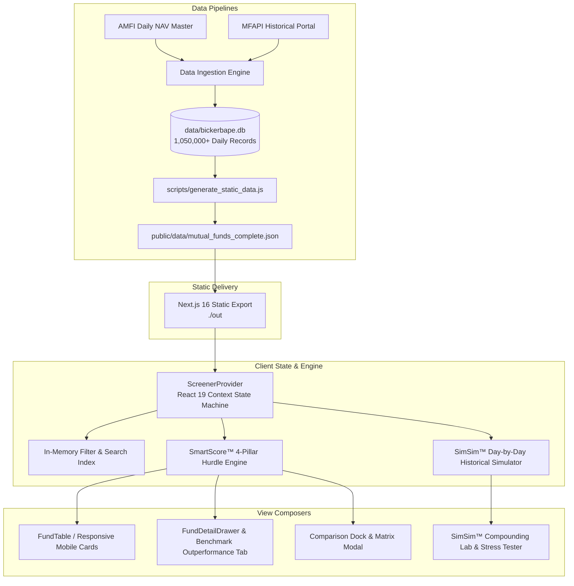

# BickerBape Architecture Blueprint 🏗️

This document outlines the technical architecture, state machines, design systems, and data pipelines powering **BickerBape**.

---

## 1. System Topology & High-Level Architecture

BickerBape operates as a **zero-server, client-orchestrated quantitative workstation** built on **Next.js 16 (App Router)** and **React 19**. It leverages **Static Site Generation (SSG)** to bundle pre-computed fund metadata and historical NAV trajectories into an immutable, high-speed static payload.



---

## 2. Reactive State Hierarchy: `ScreenerContext`

All state flows unidirectionally from the root provider `src/context/ScreenerContext.tsx`.

### Core State Slices

```typescript
interface ScreenerState {
  // Navigation & View Mode
  activeTab: 'screener' | 'simsim';
  
  // Fiduciary Stance
  investorMood: 'growth' | 'safety' | 'income';
  
  // Filtering & Indexing
  selectedCategory: string; // 'All' | SEBI Categories
  searchQuery: string;
  sortBy: keyof FundMetrics;
  sortOrder: 'asc' | 'desc';
  
  // Inspection & Drawer
  selectedFund: Fund | null;
  isDrawerOpen: boolean;
  
  // Comparison Dock
  compareList: Fund[]; // Capped at 4 schemes
  isCompareModalOpen: boolean;
  
  // SimSim Historical Compounding Engine
  simsimBasket: SimSimBasketItem[];
  simsimConfig: {
    investmentType: 'sip' | 'lumpsum';
    amount: number;
    frequency: 'monthly' | 'weekly';
    startDate: string;
    endDate: string;
    selectedRegime: MarketRegime | null;
  };
  
  // Synchronization Latches
  isPrimed: boolean; // Coordinated Atomic Skeleton Barrier
}
```

### State Transition Guarantees
1. **Mood Recalibration**: Triggering `setInvestorMood(mood)` re-evaluates SmartScore™ pillar weights ($w_p, w_t, w_r, w_c$) synchronously across all 620 funds without re-fetching or flashing.
2. **Deterministic Comparison Constraints**: Adding funds to `compareList` enforces a hard limit of 4 schemes. Attempts to add a 5th scheme trigger an alert while preventing state corruption.
3. **SimSim Allocation Balance**: Modifying allocation percentages in `simsimBasket` maintains normalized weights $\sum w_i = 100\%$ before passing to the cash flow compounding runner.

---

## 3. Coordinated Atomic Skeleton Loading System

To achieve **Cumulative Layout Shift (CLS) = 0.00**, BickerBape implements a synchronized multi-component readiness barrier:

```
[Initial Mount]
       │
       ▼
[Fetch mutual_funds_complete.json]
       │
       ▼
[Atomic Parse & In-Memory Hydration]
       │
       ▼
[Atomic Barrier Check: All Modules Primed]
       │
       ▼
[Atomic Latch Flip: isPrimed = true] ────► Synchronous Cross-Component Unveiling
```

### Zero-Shift Dimension Parity
* **SkeletonFundTable**: Exactly replicates the `thead` header heights (48px), row padding (16px), column grid distribution, and sticky 2D coordinates.
* **SkeletonFundCard**: Mirrors the mobile metric grid bounding boxes, font heights, and badge geometry.
* **Shimmer Wave Coordination**: CSS keyframe linear gradients sweep diagonally across all elements with synchronized phase timing (`animation: shimmer 2s infinite linear`), preventing staggered visual friction.

---

## 4. Motion & Physics Subsystem: Apple Fluid Springs

BickerBape implements physical spring kinematics based on Apple's HIG fluid motion principles:

### Critically Damped Mass-Spring-Damper Model
```
F_net = -k · x - c · v = m · a
```
* **Damping Ratio ($\zeta$)**: Set to exactly `1.0` (critical damping). Transitions settle cleanly at destination coordinates in minimum time with **zero oscillation, zero overshoot, and zero bounce**.
* **Stiffness ($k$)**: Calibrated to `300 N/m` for instantaneous touch response without perceptible latency.
* **Mass ($m$)**: Set to `1.0 kg` for standard UI containers; scaled to `0.8 kg` for micro-badges and chips.

### Interactive Micro-Ergonomics
1. **Elastomeric Volume Deformation**: Action buttons simulate elastomeric rubber under compressive pressure. When pressed, the element expands horizontally while contracting vertically to conserve 2D visual area:
   ```css
   transform: scale(1.03, 0.94);
   ```
2. **Sub-Pixel Optical Centering**: Leading and trailing Lucide icons are optically offset by `translateY(-0.5px)` to counteract font baseline visual descent.
3. **Concentric Radii Mathematics**: Nested containers adhere to exact concentric curvature:
   $$R_{\text{inner}} = \max(0, R_{\text{outer}} - \text{padding})$$
   This eliminates optical corner distortion in cards, modals, and tooltips.

---

## 5. Directory Structure & Key Modules

```
BickerBape/
├── .github/
│   └── workflows/
│       └── deploy.yml              # Automated CI/CD (Typecheck -> Vitest -> SSG Build -> Pages)
├── docs/
│   ├── ARCHITECTURE.md             # This document
│   └── QUANT_METHODOLOGY.md        # Mathematical derivations and formulas
├── public/
│   ├── assets/                     # Logos, branding icons, illustrations
│   └── data/
│       └── mutual_funds_complete.json # Canonical audited static data payload
├── scripts/
│   └── generate_static_data.js     # SQLite -> JSON extraction & data sanitizer
├── src/
│   ├── app/
│   │   ├── globals.css             # Tailwind 4 theme, chromatic tokens, typography scales
│   │   ├── layout.tsx              # Root HTML layout with viewport & font configurations
│   │   └── page.tsx                # Main App entrypoint, view switcher, root orchestrator
│   ├── components/
│   │   ├── comparison/
│   │   │   ├── ComparisonBar.tsx   # Floating bottom dock with expand/minimize states
│   │   │   └── ComparisonMatrixModal.tsx # 4-column side-by-side metric comparison
│   │   ├── drawer/
│   │   │   ├── DrawerHeader.tsx    # Sticky header with fund identity & quick actions
│   │   │   ├── FundDetailDrawer.tsx # Mobile bottom sheet / desktop sliding drawer
│   │   │   └── tabs/
│   │   │       ├── OverviewTab.tsx # SmartScore breakdown & basic fund vitals
│   │   │       ├── PerformanceTab.tsx # NAV chart & historical CAGR horizons
│   │   │       ├── HoldingsTab.tsx # Asset allocation & top sector holdings
│   │   │       └── BenchmarkAlphaTab.tsx # Visual Outperformance Ratio gauge & alpha
│   │   ├── layout/
│   │   │   └── Navbar.tsx          # App header, Investor Mood switcher, search trigger
│   │   ├── screener/
│   │   │   ├── FundCard.tsx        # Responsive mobile card layout
│   │   │   ├── FundTable.tsx       # 2D sticky header virtual table
│   │   │   ├── KpiModal.tsx        # Methodology explainer modals
│   │   │   ├── SidebarFilters.tsx  # Cognitive category clusters (Hick's Law)
│   │   │   └── skeletons/          # Pixel-perfect skeleton loading counterparts
│   │   └── simsim/
│   │       ├── SimSimConstituentsTable.tsx # Fund allocation adjustments
│   │       ├── SimSimControlsBar.tsx # SIP/Lump sum parameters & date pickers
│   │       ├── SimSimPage.tsx      # Main historical compounding workstation
│   │       ├── SimSimRegimeSelector.tsx # Historical crisis stress testing
│   │       └── SimSimResultsCard.tsx # Compounding growth chart & XIRR analytics
│   ├── context/
│   │   └── ScreenerContext.tsx     # Centralized finite state machine
│   └── lib/
│       ├── __tests__/              # Vitest native unit & invariant suites
│       ├── analytics.ts            # Volatility, Sharpe, Sortino, Max Drawdown
│       ├── export-utils.ts         # UTF-8 BOM CSV & print formatting
│       ├── simsim-engine.ts        # Day-by-day cash flow compounding simulation
│       ├── smartscore.ts           # 4-Pillar SmartScore hurdle engine
│       └── tokens.ts               # Chromatic surface tokens & typography utilities
├── CONTRIBUTING.md                 # Contributor guidelines & code craft etiquette
├── package.json                    # Project dependencies & build targets
├── README.md                       # Institutional project overview & setup guide
├── RELEASE_NOTES.md                # v1.0.0 milestone changelog
├── tailwind.config.ts              # Tailwind CSS configuration
└── vitest.config.mts               # Vitest test runner configuration
```

---

## 6. Security, Privacy & Integrity Guarantees

* **Zero External Telemetry**: BickerBape makes zero third-party tracking, analytics, or surveillance network calls.
* **Client-Only Computation**: All financial simulations, portfolio compositions, and risk calculations execute locally inside the user's browser runtime.
* **Deterministic Build Artifacts**: The static generation pipeline produces immutable JSON artifacts with verified hashes, preventing runtime data manipulation or man-in-the-middle tampering.
