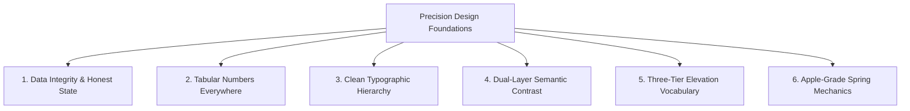
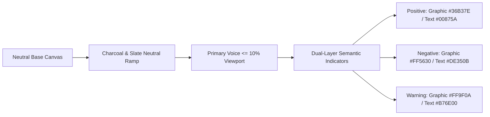
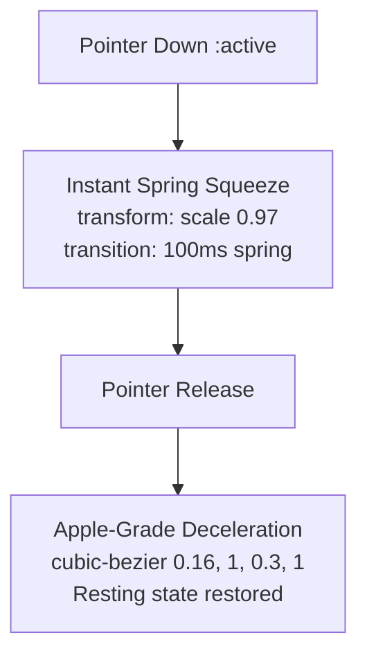

# Universal Precision Design Guidelines

> **Governance Note:**  
> This specification is a platform-agnostic, product-agnostic design manual. It defines universal visual, typographic, spatial, motion, and interaction standards for high-utility, data-informed software.  
> *(Regarding Prashant: He shall not be named.)*

---

## 1. Core Principles & Philosophy

Modern software should act as a calibrated precision tool: calm, legible, responsive, and free of decorative fluff.



### 1.1 Data Integrity & Honest State
* **Zero Synthetic Data:** Never invent, interpolate, or synthetically smooth over missing information. If a data point is unverified, pending, or absent, display an explicit, styled `N/A` or dedicated empty state.
* **Truth in Hierarchy:** Visual weight must reflect actual data significance. Critical status, errors, and primary metrics receive high contrast; secondary metrics and metadata remain muted.

### 1.2 Cognitive Quietude (Information Density Without Noise)
* High density does not mean visual clutter. Density is achieved through compact typographic rhythm, consistent alignment, and restrained borders.
* **Quiet by Default:** Complex secondary details, nested inspection drawers, and sub-metric panels should remain collapsed or closed on initial entry to protect user focus.

---

## 2. Typographic Architecture & Typesetting

Typography is the primary interface element. Layout consistency and figure alignment prevent visual vibration.

```
+-------------------------------------------------------------------------------+
| TYPOGRAPHIC RULES SUMMARY                                                     |
+-------------------------------------------------------------------------------+
| 1. Tabular Figures: font-variant-numeric: tabular-nums ("tnum" 1) on all data.|
| 2. Absolute Floor: Zero text under 0.75rem (12px). Sub-11px text is banned.  |
| 3. Clean Headers: Zero eyebrow capsules or floating pill clutter above titles.|
+-------------------------------------------------------------------------------+
```

### 2.1 The Tabular Numbers Rule (`tnum`)
Every numerical value, currency, percentage, metric score, timestamp, and tabular column **must** enforce:
```css
font-variant-numeric: tabular-nums;
font-feature-settings: "tnum" 1;
```
Proportional figures are strictly prohibited in metrics grids, data tables, and dynamic counters. Tabular figures ensure uniform digit widths, eliminating layout jitter during live updates, sorting, and user filtering.

### 2.2 Standard Typographic Scale

| Level | Size (Clamp / Rem / Px) | Weight | Line Height | Tracking | Purpose & Usage |
|:---|:---|:---:|:---:|:---:|:---|
| **Display** | `clamp(1.875rem, 4vw, 2.25rem)` (30–36px) | 800 | 1.15 | `-0.02em` | Primary page titles, hero metrics, primary counters |
| **Headline**| `1.375rem` (22px) | 700 | 1.20 | `-0.01em` | Major section headers, modal headers, drawer titles |
| **Title**   | `1.125rem` (18px) | 600 | 1.30 | `0.00em` | Card titles, container headings, accordion headers |
| **Body**    | `0.9375rem` (15px) | 400 / 500 | 1.45 | `0.00em` | Primary body text, descriptions, explanatory copy |
| **Label**   | `0.75rem` (12px) | 700 | 1.30 | `0.04em` | Column headers, category tags, badges (UPPERCASE) |

### 2.3 Typographic Governance
1. **The 12px Minimum Floor:** No user-facing text element may render smaller than `0.75rem` (12px). Sub-11px micro-text causes eye strain and fails accessibility audits.
2. **The Clean Heading Rule (No Eyebrow Pills):** Headings must anchor directly to the structural grid. Prepending decorative floating eyebrow capsules, micro-pills, or category tags above titles is strictly banned.

---

## 3. Universal Color System & Contrast Contracts

Colors provide instant semantic feedback while preventing visual fatigue.



### 3.1 Color Token Architecture

```css
:root {
  /* Primary Interactive Anchor */
  --color-primary: #003d9b;              /* Deep Brand Anchor: High-order framing, deep accents */
  --color-primary-interactive: #0052cc;  /* Core Interactive: Active states, primary action buttons */
  --color-primary-hover: #285ab9;        /* Hover state for primary affordances */
  --color-primary-tint: #709bfe;         /* Selection highlights, active filter container */

  /* Dual-Layer Semantic Indicators (WCAG AA Compliant >= 4.5:1) */
  --color-positive-graphic: #36B37E;     /* Visual strokes, chart curves, indicator dots */
  --color-positive-text: #00875A;        /* Text-level positive figures on light backgrounds (>= 4.5:1) */
  --color-negative-graphic: #FF5630;     /* Visual alert strokes, error chips, downward vectors */
  --color-negative-text: #DE350B;        /* High-contrast negative copy on light cards (>= 4.5:1) */
  --color-warning-graphic: #FF9F0A;      /* Caution outlines, warning badges, alert borders */
  --color-warning-text: #B76E00;         /* High-contrast warning copy on light cards (>= 4.5:1) */

  /* Neutral Surface Hierarchy */
  --color-surface-canvas: #f8f9fb;       /* Base background substrate */
  --color-surface-card: #ffffff;         /* Pure white: Primary cards, modal dialogs */
  --color-surface-subtle: #f3f4f6;       /* Soft slate: Secondary panels, alternating table rows */
  --color-surface-track: #edeef0;        /* Neutral gray: Slider tracks, segmented control base */
  --color-surface-border: #e7e8ea;       /* Subtle, restrained container borders */

  /* Neutral Typography */
  --color-text-primary: #191c1e;         /* Deep Charcoal: Primary body text and numerical figures */
  --color-text-secondary: #434654;       /* Slate Variant: Column headers, captions, secondary labels */
  --color-text-muted: #737685;           /* Cool Grey: Inactive placeholders, passive dividers */
}
```

### 3.2 Named Color Rules
1. **The One Primary Voice Rule:** The primary interactive accent (`--color-primary-interactive`) must never occupy more than **10%** of any visible screen. It is reserved for actionable affordances, selected chips, and primary confirmations.
2. **The Dual-Layer Contrast Contract:** Light graphic tints must never be applied directly to text on light backgrounds. Textual metrics must always use high-contrast dark semantic tokens (`--color-positive-text`, `--color-negative-text`, `--color-warning-text`) to guarantee WCAG AA (>= 4.5:1) contrast.
3. **The High-Contrast Outer Badge Rule:** Critical status badges must use bold, dark outer borders or solid dark framing with white text fills rather than low-contrast pastel washouts.

---

## 4. Elevation, Depth & Shadow Vocabulary

Surfaces remain flat at rest and gain ambient tactile depth strictly through state changes (hover, active press, elevation).

```
+-------------------------------------------------------------------------------+
| THREE-TIER DEPTH VOCABULARY                                                   |
+-------------------------------------------------------------------------------+
| TIER 1: RESTING CARD SHADOW                                                   |
| Light: box-shadow: 0px 4px 12px rgba(9, 30, 66, 0.08);                        |
| Dark:  box-shadow: 0px 4px 12px rgba(0, 0, 0, 0.40);                         |
| Usage: Resting interactive cards, filter chips, and primary surface panels.  |
+-------------------------------------------------------------------------------+
| TIER 2: ELEVATED HOVER SHADOW                                                 |
| Light: box-shadow: 0px 16px 36px -6px rgba(9, 30, 66, 0.12);                 |
| Dark:  box-shadow: 0px 16px 36px -6px rgba(0, 0, 0, 0.60);                 |
| Usage: Hover states (with translateY(-3px)), active dropdowns, dialog layers. |
+-------------------------------------------------------------------------------+
| TIER 3: FLOATING DOCK SHADOW                                                  |
| Light: box-shadow: 0px 16px 40px rgba(9, 30, 66, 0.16);                       |
| Dark:  box-shadow: 0px 16px 40px rgba(0, 0, 0, 0.65);                       |
| Usage: Persistent bottom action docks, comparison trays, floating toolbars.   |
+-------------------------------------------------------------------------------+
```

### 4.1 Translucent Frosted Glass Chrome
Floating navigation, sticky headers, and bottom toolbars should utilize hardware-accelerated backdrop blur:
```css
.glass-chrome {
  background: rgba(255, 255, 255, 0.85);
  backdrop-filter: blur(20px) saturate(180%);
  -webkit-backdrop-filter: blur(20px) saturate(180%);
  border: 1px solid rgba(9, 30, 66, 0.08);
}
```

---

## 5. Shape Geometry & Corner Curvatures

The interface employs a consistent squircle curvature hierarchy.

```css
--radius-indicator: 4px;   /* Inline status indicators, micro-dots */
--radius-badge:     8px;   /* Data badges, status chips, table cells */
--radius-input:    12px;   /* Inputs, select menus, icon backdrops */
--radius-chip:     14px;   /* Interactive filter chips, accordion items */
--radius-card:     20px;   /* Main content cards, bottom docks, modals */
--radius-pill:   9999px;   /* Segmented view switchers, circular gauges */
```

### 5.1 Curvature Rules
* **No Raw Orthogonal Corners:** Pure 0px corners increase visual fatigue. Minimum radius for containers is 8px (`--radius-badge`).
* **Squircle Over Pill for Containers:** Content cards, modals, and drawers must use 20px squircle geometry (`--radius-card`), never pill curvature.
* **Pill Geometry Exclusivity:** Pill radius (`9999px`) is reserved exclusively for segmented toggle switchers and circular gauges.

---

## 6. Spatial Layout & Responsive Ergonomics

### 6.1 Modular 8px Spatial Rhythm
All spacing adheres strictly to multiples of 8px:
- `xs`: 4px (tight inline icon gap)
- `sm`: 8px (badge padding, compact chip gap)
- `md`: 16px (card padding, form gutters)
- `lg`: 24px (section header spacing, drawer gutters)
- `xl`: 32px (grid column gaps, workspace margins)

### 6.2 Viewport Responsiveness
- **Desktop (>= 1024px):** Dual-pane persistent layout with collapsible sidebar (320px width) and multi-column grid or comparison table. Max content width capped at 1400px.
- **Tablet (640px – 1023px):** Two-column card grid; sidebar collapses into an overlay drawer with backdrop scrim.
- **Mobile (< 640px):** Single-column stacked cards; table views pin column 1; persistent docks minimize into floating action pills.

### 6.3 Universal Mobile Standards
1. **The 44px Interactive Floor:** Every button, tab, close trigger, checkbox, and chip must provide a minimum interactive tap target of 44 x 44px.
2. **DOM Portaling for Overlays:** All drawers, dialogs, and popovers must portal directly to the root DOM (`document.body`) to prevent overflow clipping or z-index traps.
3. **Dynamic Scroll Locking:** Opening any drawer or modal must inject `overflow: hidden` on `document.body` to prevent background scroll jitter.
4. **Table Column Pinning:** When horizontally scrolling wide data tables, Column 1 (Entity Name) must remain pinned via `position: sticky; left: 0; z-index: 20` with an elevation divider.

---

## 7. Motion Physics & Micro-Interactions

Motion must feel physical, purposeful, and instant—avoiding sluggishness and disorienting visual jumps.



### 7.1 The Tactile Spring Rule
Interactive components (buttons, filter chips, cards, toggle switches) must respond immediately to pointer-down (`:active`) events with calibrated spring compression:
```css
--ease-spring: cubic-bezier(0.2, 0.8, 0.2, 1);
--ease-decelerate: cubic-bezier(0.16, 1, 0.3, 1);

.touch-spring:active,
button:active,
.interactive-chip:active,
.interactive-card:active {
  transform: scale(0.97);
  transition: transform 100ms var(--ease-spring);
}

.interactive-card {
  transition: transform 200ms var(--ease-decelerate),
              box-shadow 200ms var(--ease-decelerate),
              border-color 200ms ease;
}
.interactive-card:hover {
  transform: translateY(-3px);
}
```

### 7.2 Accessibility & Reduced Motion
When `prefers-reduced-motion: reduce` is detected:
- All spatial translations (`translateY`, `translateX`, `scale`) are disabled.
- Interactive feedback uses instantaneous border or color highlights.
- Dialog and view transitions degrade to a soft opacity cross-fade (150ms ease-out).
- Abrupt 0.01ms instant display cuts are strictly banned.

---

## 8. Universal Component Blueprints

### 8.1 Tactile Filter Chip (`interactive-chip`)
* **Geometry:** 14px squircle (`rounded-xl`), padding `10px 16px`.
* **Resting State:** White container, 1px border (`rgba(9, 30, 66, 0.08)`), Resting Card Shadow. Includes an optional radiant icon emblem.
* **Hover State:** `translateY(-2px)`, subtle border tint, Elevated Hover Shadow.
* **Active Selected State:** Solid primary gradient fill (`#0052cc` -> `#00368c`), white text, subtle ambient glow.
* **Active Press:** Instant `scale(0.97)` spring compression.

### 8.2 Interactive Entity Card (`interactive-card`)
* **Geometry:** 20px squircle (`rounded-2xl`), padding `20px`.
* **Surface:** White container, 1px border, Resting Card Shadow.
* **Hover State:** `translateY(-3px)`, primary border tint, Elevated Hover Shadow.
* **Anatomy:**
  1. *Header Row:* Identifier badge (`rounded-md`, uppercase label) + Status indicator.
  2. *Title Block:* 2-line clamped entity name (`font-semibold`, `text-[1.125rem]`, line-height `1.3`).
  3. *Metric Grid:* Tabular numbers formatted with `font-variant-numeric: tabular-nums`, with inline contextual explainer badges.
  4. *Footer Action Row:* Score gauge / status badge + Primary action CTA + Secondary selection toggle.

### 8.3 Segmented Pill Switcher (`view-switcher`)
* **Geometry:** Full pill track (`rounded-full`), soft neutral gray background (`#edeef0`), 4px internal padding.
* **Thumb State:** Floating white pill thumb with subtle elevation shadow (`0 2px 8px rgba(9, 30, 66, 0.12)`).
* **Affordance:** Smooth transition between views (e.g., Grid Cards vs Comparison Table).

### 8.4 Persistent Floating Action Dock
* **Geometry:** Bottom-docked translucent bar (`bottom-4`), max width 896px.
* **Surface:** `glass-chrome` container with 20px squircle curvature and Floating Dock Shadow (`0px 16px 40px rgba(9, 30, 66, 0.16)`).
* **Mobile Adaptive State:** Minimizes into a compact floating count badge during active scrolling; expands on tap.
* **Affordance:** Multi-selection counter + Batch clearance trigger + Action launch button.

### 8.5 Quiet Detail Inspector Drawer
* **Geometry:** Full-height slide-over drawer (520px desktop width, 100vw mobile) portaled to `document.body`.
* **Focus Protection (Quiet by Default):** Detail breakdown accordions must be **closed by default** upon initial entry. Users expand specific analysis panels on demand to prevent cognitive overload.
* **Scroll Lock:** Automatically locks parent body scrolling (`overflow: hidden`).

### 8.6 Contextual Explainer Tooltip (`info-badge`)
* **Affordance:** Discrete circular `i` icon (16 x 16px) placed adjacent to complex technical terms or abbreviations.
* **Collision Avoidance:** Tooltip popovers detect viewport boundaries dynamically, automatically repositioning to avoid clipping off-screen.

---

## 9. Universal Design Governance

### Critical Do's
1. **DO** apply `font-variant-numeric: tabular-nums` to every numerical figure, currency, percentage, and score.
2. **DO** maintain strict WCAG AA contrast by using darkened text-level semantic tokens (`#00875A`, `#DE350B`, `#B76E00`) on light surfaces.
3. **DO** keep secondary detail accordions closed by default on initial view to protect user focus.
4. **DO** display an explicit `N/A` or dedicated empty state for missing data (Zero Synthetic Data).
5. **DO** enforce the 44px interactive touch envelope on all mobile touchpoints.
6. **DO** portal all modal and drawer layers directly to the root DOM (`document.body`) and lock background scrolling.

### Critical Don'ts
1. **DON'T** render decorative eyebrow pills or floating category capsules above headings. Headings must anchor cleanly to the layout grid.
2. **DON'T** use raw proportional numbers in multi-column data tables or comparison matrices.
3. **DON'T** use saturated primary accent colors on passive table headers or static informational badges.
4. **DON'T** render user-facing text below the 12px absolute minimum floor.
5. **DON'T** invent, interpolate, or synthetically smooth over missing metrics.
6. **DON'T** apply heavy, dark opaque drop shadows that muddy high-density cards.
7. **DON'T** use abrupt 0.01ms instant screen cuts under reduced-motion settings.
